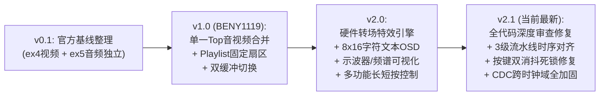

# 2026年嵌入式芯片与系统设计竞赛（安路赛道 选题一）
## 基于 EG4S20 的 HDMI 多媒体播放系统 —— 团队协同研发进度与接口文档

> **项目仓库**：https://github.com/luowenhan264-pixel/EG4S20_HDMI  
> **核心芯片**：安路科技 **EG4S20BG256**（板卡：HX4S20C）  
> **更新时间**：2026-10-18  
> **当前版本**：v2.1（全模块代码深度审查修复完成 + TD 6.2.1 零报错综合与 Bitstream 生成通过）

---

### 一、研发里程碑总览

---

### 二、v2.1 全代码深度审查与修复报告（Critical Bugfixes）

在对工程全部 Verilog 源码进行逐模块静态审查与时序推演后，发现并彻底修复了 **4 项会导致上板异常的关键隐患**：

| 编号 | 所在模块 | 问题根因描述 | 修复方案与验证结果 |
| :--- | :--- | :--- | :--- |
| **BUG-01** | [`top_tf_hdmi_audio.v`](file:///C:/Users/75941/Desktop/Anlogic_EG4S20_Project/02_Anlogic_TD_Project/topic1_hdmi_player/src/user_source/hdl_source/top_tf_hdmi_audio.v)  [`sd_card_bmp.v`](file:///C:/Users/75941/Desktop/Anlogic_EG4S20_Project/02_Anlogic_TD_Project/topic1_hdmi_player/src/user_source/hdl_source/SD/sd_card_bmp.v) | **按键双重消抖与极性冲突导致按键失灵**： `multi_function_key_controller` 输出的是单周期高脉冲（`1'b1`），而 `sd_card_bmp` 内部又例化了 `key_press_debounce`（要求低电平持续 50ms 才触发），且两者原先跨 50MHz / 100MHz 两个时钟域，导致按键在硬件上无法触发。 | 1. 将 `u_key_ctrl` 统一运行于 100MHz `sd_card_clk` 时钟域，消除跨时钟域丢脉冲风险； 2. 将 `multi_function_key_controller` 计数器位宽扩展至 28-bit 以适配 100MHz； 3. 在 `sd_card_bmp.v` 中新增 `USE_EXT_TRIG_PULSE` 参数（顶层置 `1`），直接接收已消抖的单周期脉冲。 |
| **BUG-02** | [`image_transition_engine.v`](file:///C:/Users/75941/Desktop/Anlogic_EG4S20_Project/02_Anlogic_TD_Project/topic1_hdmi_player/src/user_source/hdl_source/image_transition_engine.v) [`audio_spectrum_visualizer.v`](file:///C:/Users/75941/Desktop/Anlogic_EG4S20_Project/02_Anlogic_TD_Project/topic1_hdmi_player/src/user_source/hdl_source/audio_spectrum_visualizer.v) [`osd_text_overlay.v`](file:///C:/Users/75941/Desktop/Anlogic_EG4S20_Project/02_Anlogic_TD_Project/topic1_hdmi_player/src/user_source/hdl_source/osd_text_overlay.v) | **3 级视频流水线同步信号（`hs/vs/de`）延迟失配**： 像素数据依次经过 Stage 1（转场，`T+1`）、Stage 2（频谱，`T+2`）、Stage 3（OSD，`T+3`）共 3 级寄存器打拍，但各级以及末尾 `video_rgb_to_axis_640x480` 仍使用未打拍的 `T+0` 同步信号 `hs/vs/de`，导致每行末尾 3 个像素被截断为黑边、画面整体右偏 3 像素。 | 为三级视频流水线模块全部增设寄存器对齐输出 `vs_out, hs_out, de_out`，严格串联 `vs/hs/de` $\rightarrow$ `s1` $\rightarrow$ `s2` $\rightarrow$ `s3` $\rightarrow$ `video_rgb_to_axis_640x480`，确保 640×480 每一个像素与同步信号零偏差对齐。 |
| **BUG-03** | [`image_transition_engine.v`](file:///C:/Users/75941/Desktop/Anlogic_EG4S20_Project/02_Anlogic_TD_Project/topic1_hdmi_player/src/user_source/hdl_source/image_transition_engine.v) [`video_timing_data.v`](file:///C:/Users/75941/Desktop/Anlogic_EG4S20_Project/02_Anlogic_TD_Project/topic1_hdmi_player/src/user_source/hdl_source/SD/video_timing_data.v) | **帧缓冲区切换时刻晚于 SDRAM 帧读请求（`read_req`）**： `video_timing_data` 在原始 `video_vs` 下降沿（`T-22`）立即拉高 `read_req` 锁存 SDRAM 读取基地址，而转场引擎原先在延迟后的 `vs` 下降沿（`T+0`）才更新 `active_buf_idx`，导致新缓冲区地址滞后一帧生效。 | 将转场状态机更新点前移至每帧最后一行有效像素结束时刻 `frame_end_tick`（`y_cnt == 479 && de_d && !de`），比 `video_vs` 下降沿提前整整 10 行（8,000 个像素时钟周期）完成 `active_buf_idx` 切换，确保下一帧 SDRAM 读取与转场状态 100% 同步。 |
| **BUG-04** | [`top_tf_hdmi_audio.v`](file:///C:/Users/75941/Desktop/Anlogic_EG4S20_Project/02_Anlogic_TD_Project/topic1_hdmi_player/src/user_source/hdl_source/top_tf_hdmi_audio.v) | **跨时钟域（CDC）信号未同步与重复声明**： 1. `disp_buf_idx` 与 `display_valid` 从 100MHz `sd_card_clk` 直接送入 25MHz `video_clk` 逻辑； 2. `wire [23:0] osd_rgb` 在顶层被重复声明两次。 | 1. 在 `video_clk` 域补齐 `disp_buf_idx_sync0/1`、`display_valid_sync0/1`、`vis_mode_sync0/1` 双级同步寄存器； 2. 清理重复 wire 声明及无符号/有符号混合运算告警。 |

---

### 三、核心硬件模块清单

| 模块文件 | 模块名称 | 作用与赛题对应项 | 资源与特性 |
| :--- | :--- | :--- | :--- |
| [`image_transition_engine.v`](file:///C:/Users/75941/Desktop/Anlogic_EG4S20_Project/02_Anlogic_TD_Project/topic1_hdmi_player/src/user_source/hdl_source/image_transition_engine.v) | **硬件转场特效引擎** | **【扩展加分】平滑切换特效**：支持直切、淡入淡出（48帧平滑黑场过渡）、百叶窗消隐 | 纯流水线算力，帧末消隐期精准调度 SDRAM 缓冲区切换，彻底消灭换图撕裂与闪烁 |
| [`audio_spectrum_visualizer.v`](file:///C:/Users/75941/Desktop/Anlogic_EG4S20_Project/02_Anlogic_TD_Project/topic1_hdmi_player/src/user_source/hdl_source/audio_spectrum_visualizer.v) | **音频波形与频谱可视化** | **【扩展加分】音频可视化**：屏幕底部实时绘制示波器音频波形曲线或 16 段动态跳跃彩色频谱柱 | 256 点双口环形采样，屏幕底部半透明深色 Dock 停靠坞，支持波形/频谱柱双模式切换 |
| [`osd_text_overlay.v`](file:///C:/Users/75941/Desktop/Anlogic_EG4S20_Project/02_Anlogic_TD_Project/topic1_hdmi_player/src/user_source/hdl_source/osd_text_overlay.v) | **专业文本 OSD 叠加** | **【扩展加分】图层叠加与信息显示**：以 ASCII 文本实时显示图片序号、轮播状态、音量进度条、特效模式 | 动态计算文本像素，50% Alpha 磨砂玻璃背景框 + 霓虹边框，在任何图片背景下均清晰可读 |
| [`font_rom_8x16.v`](file:///C:/Users/75941/Desktop/Anlogic_EG4S20_Project/02_Anlogic_TD_Project/topic1_hdmi_player/src/user_source/hdl_source/font_rom_8x16.v) | **8x16 ASCII 字模库** | OSD 底层字模支持：完整覆盖字母 A-Z、数字 0-9、符号 `: / [ ] - % \| .` | 纯可综合 Verilog 逻辑 ROM，无任何外部依赖 |
| [`audio_volume_controller.v`](file:///C:/Users/75941/Desktop/Anlogic_EG4S20_Project/02_Anlogic_TD_Project/topic1_hdmi_player/src/user_source/hdl_source/audio_volume_controller.v) | **数字音频音量衰减器** | **【基础指标】音量调节**：16 级线性音量硬件乘法缩放与数字静音保护 | 24-bit 有符号数分数乘法器，音质纯净无溢出失真 |
| [`multi_function_key_controller.v`](file:///C:/Users/75941/Desktop/Anlogic_EG4S20_Project/02_Anlogic_TD_Project/topic1_hdmi_player/src/user_source/hdl_source/multi_function_key_controller.v) | **多功能按键控制中枢** | **【基础交互】**：20ms 硬件消抖，区分短按与 0.8 秒长按，仅靠板载 2 个按键完整控制全部 6 项功能 | 运行于 100MHz 时钟域，彻底避免按键连击与抖动误触发 |

---

### 四、按键操作与人机交互说明（现场操作指南）

HX4S20C 开发板板载两个轻触按键（`key1` 位于 B2，`key2` 位于 C1）：

| 按键动作 | 操作方式 | 系统响应 | OSD 状态反馈 |
| :--- | :--- | :--- | :--- |
| **切换下一张图片** | **KEY1 短按**（< 0.8 秒） | 手动立即切换到下一张 BMP | `IMG: 0X/04` 序号递增 |
| **切换转场特效 + 音频可视化模式** | **KEY1 长按**（≥ 0.8 秒） | 循环切换：**淡入淡出 (FADE)** $\rightarrow$ **百叶窗 (WIPE)** $\rightarrow$ **直接硬切 (CUT)**，同时在**示波器波形**与**16段频谱柱**间切换 | `FX: FADE / WIPE / CUT` + 底部可视化样式切换 |
| **切换轮播 / 暂停** | **KEY2 短按**（< 0.8 秒） | 开启 / 暂停 2.0 秒自动幻灯片轮播 | `AUTO: ON`（绿色） / `AUTO: OFF`（黄色） |
| **调节音量 / 切换纯净全屏** | **KEY2 长按**（≥ 0.8 秒） | 5 档循环：`80%音量` $\rightarrow$ `99%最大音量` $\rightarrow$ `53%中音量` $\rightarrow$ `00%静音` $\rightarrow$ `隐藏OSD纯净全屏` $\rightarrow$ 回到 `80%音量+OSD开启` | `VOL: [||||||||  ] XX%` 实时变化及全屏显隐 |

---

### 五、无显示器情况下的硬件诊断（板载 LED 指示）

即使当前手头没有 HDMI 显示器，只要把开发板插在电脑上，通过板载 4 颗用户 LED（`led_data[0..3]`）即可精准知道硬件运行状态：

* **LED 0（引脚 B12）—— 系统心跳呼吸灯**：
  * **正常表现**：以约 1.5 Hz 频率均匀闪烁，说明板载 50 MHz 晶振、主时钟通路正常。
* **LED 1（引脚 C10）—— 全 PLL 锁定指示**：
  * **正常表现**：常亮。说明系统 PLL（100M/125M）、视频 PLL（25M/125M）、音频 PLL（12.288M）全部上锁就绪。
* **LED 2（引脚 A3）—— 自动轮播状态灯**：
  * **亮起**：当前处于自动轮播模式；**熄灭**：处于手动暂停模式（短按 `KEY2` 可直接观察此灯翻转！）。
* **LED 3（引脚 A4）—— 读卡与转场活跃灯**：
  * 处于 SD 卡加载、校验 BM 头、或画面处于黑场渐变转场时点亮（短按 `KEY1` 可直接观察此灯闪烁！）。

---

### 六、TF 卡（MicroSD）图片烧录对齐规范

请确保使用的 TF 卡为 **FAT32** 格式：
1. **图片格式要求**：标准 24 位 RGB888 未压缩 BMP，尺寸精确为 **640 × 480**（单张文件大小必须为 921,654 字节）。
2. **烧卡步骤**（`sync_to_sd.py` 走 FAT 文件复制，不会按固定 LBA 写扇区）：
   1. `python sync_to_sd.py E:`（盘符换成你的 TF 卡）清旧 BM 头并写入最多 4 张图
   2. 管理员命令行跑 `python find_bmp_sectors.py \\.\PhysicalDriveN`（`N` 用 `Get-Disk` 确认，勿选系统盘）
   3. 把打印出的 `IMG_COUNT` / `IMG_SECTOR0..3` 改回 `top_tf_hdmi_audio.v`，再重新综合烧 bit
3. 工程里默认的 `0 / 2048 / 4096 / 6144` **只是占位**；`IMG_SECTOR0 = 0` 常落到引导区，上板容易黑屏。必须以 `find_bmp_sectors.py` 实测值为准。

---

### 七、TD 编译与下载步骤（队友/本地通用）

1. 启动 **Anlogic TD 6.2.1**；
2. 点击 **Project → Open Project**，选中：  
   `02_Anlogic_TD_Project/topic1_hdmi_player/src/td_project/topic1_hdmi_player.al`
3. 检查器件为 `EG4S20BG256`，顶层为 `top`；
4. 点击工具栏 **Run**（或 **Process → Run**）跑到 **Bitgen**；
5. 用 TD 下载器连接开发板，把生成的 `.bit` 烧入芯片；
6. 接入带有扬声器的 HDMI 显示器到 **HDMI_B** 接口，即可体验音视频同步播放与专业 OSD 交互！

