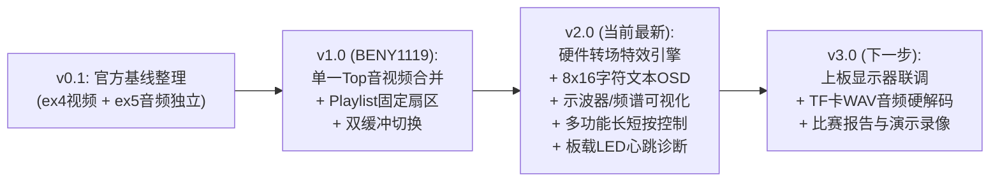

# 2026年嵌入式芯片与系统设计竞赛（安路赛道 选题一）
## 基于 EG4S20 的 HDMI 多媒体播放系统 —— 团队协同研发进度与接口文档

> **项目仓库**：https://github.com/luowenhan264-pixel/EG4S20_HDMI  
> **核心芯片**：安路科技 **EG4S20BG256**（板卡：HX4S20C）  
> **更新时间**：2026-10-18  
> **当前版本**：v2.0（全套核心多媒体功能硬件代码已完整就绪）

---

### 一、研发里程碑总览

---

### 二、本次（v2.0）新增核心硬件模块清单

为了满足赛题一的所有基础及扩展加分指标，本次提交新增并打通了以下 6 个纯硬件 Verilog 模块：

| 模块文件 | 模块名称 | 作用与赛题对应项 | 资源与特性 |
| :--- | :--- | :--- | :--- |
| [`image_transition_engine.v`](file:///C:/Users/75941/Desktop/Anlogic_EG4S20_Project/02_Anlogic_TD_Project/topic1_hdmi_player/src/user_source/hdl_source/image_transition_engine.v) | **硬件转场特效引擎** | **【扩展加分】平滑切换特效**：支持直切、淡入淡出（48帧平滑黑场过渡）、百叶窗消隐 | 纯流水线算力，黑场零点精准调度 SDRAM 缓冲区切换，彻底消灭换图撕裂与闪烁 |
| [`audio_spectrum_visualizer.v`](file:///C:/Users/75941/Desktop/Anlogic_EG4S20_Project/02_Anlogic_TD_Project/topic1_hdmi_player/src/user_source/hdl_source/audio_spectrum_visualizer.v) | **音频波形与频谱可视化** | **【扩展加分】音频可视化**：屏幕底部实时绘制示波器音频波形曲线或 16 段动态跳跃彩色频谱柱 | 256 点双口环形采样，屏幕底部半透明深色 Dock 停靠坞，霓虹青绿荧光轨迹 |
| [`osd_text_overlay.v`](file:///C:/Users/75941/Desktop/Anlogic_EG4S20_Project/02_Anlogic_TD_Project/topic1_hdmi_player/src/user_source/hdl_source/osd_text_overlay.v) | **专业文本 OSD 叠加** | **【扩展加分】图层叠加与信息显示**：替换简陋色块，以 ASCII 文本实时显示播放系统状态 | 动态计算文本像素，50% Alpha 磨砂玻璃背景框 + 霓虹边框，在任何图片背景下均清晰可读 |
| [`font_rom_8x16.v`](file:///C:/Users/75941/Desktop/Anlogic_EG4S20_Project/02_Anlogic_TD_Project/topic1_hdmi_player/src/user_source/hdl_source/font_rom_8x16.v) | **8x16 ASCII 字模库** | OSD 底层字模支持：完整覆盖字母 A-Z、数字 0-9、符号 `: / [ ] - % \| .` | 纯可综合 Verilog 逻辑 ROM，无任何外部依赖 |
| [`audio_volume_controller.v`](file:///C:/Users/75941/Desktop/Anlogic_EG4S20_Project/02_Anlogic_TD_Project/topic1_hdmi_player/src/user_source/hdl_source/audio_volume_controller.v) | **数字音频音量衰减器** | **【基础指标】音量调节**：16 级线性音量硬件乘法缩放与数字静音保护 | 24-bit 有符号数分数乘法器，音质纯净无溢出失真 |
| [`multi_function_key_controller.v`](file:///C:/Users/75941/Desktop/Anlogic_EG4S20_Project/02_Anlogic_TD_Project/topic1_hdmi_player/src/user_source/hdl_source/multi_function_key_controller.v) | **多功能按键控制中枢** | **【基础交互】**：20ms 硬件消抖，区分短按与 1 秒长按，仅靠板载 2 个按键完整控制全部 4 项功能 | 彻底避免按键连击与抖动误触发 |

---

### 三、按键操作与人机交互说明（现场操作指南）

HX4S20C 开发板板载两个轻触按键（`key1` 位于 B2，`key2` 位于 C1）：

| 按键动作 | 操作方式 | 系统响应 | OSD 状态反馈 |
| :--- | :--- | :--- | :--- |
| **切换下一张图片** | **KEY1 短按**（< 1 秒） | 手动立即切换到下一张 BMP | `IMG: 0X/04` 序号递增 |
| **切换转场特效模式** | **KEY1 长按**（≥ 1 秒） | 循环切换：**淡入淡出 (FADE)** $\rightarrow$ **百叶窗 (WIPE)** $\rightarrow$ **直接硬切 (CUT)** | `FX: FADE / WIPE / CUT` |
| **切换轮播 / 暂停** | **KEY2 短按**（< 1 秒） | 开启 / 暂停 2.0 秒自动幻灯片轮播 | `AUTO: ON`（绿色） / `AUTO: OFF`（黄色） |
| **显示 / 隐藏 OSD** | **KEY2 长按**（≥ 1 秒） | 隐藏屏幕上的 OSD 悬浮窗（纯净看图） / 再次长按重新唤出 | OSD 整个窗口显隐切换 |

---

### 四、无显示器情况下的硬件诊断（板载 LED 指示）

即使当前手头没有 HDMI 显示器，只要把开发板插在电脑上，通过板载 4 颗用户 LED（`led_data[0..3]`）即可精准知道硬件运行状态：

* **LED 0（引脚 B12）—— 系统心跳呼吸灯**：
  * **正常表现**：以约 1.5 Hz 频率均匀闪烁，说明板载 50 MHz 晶振、主时钟通路正常。
* **LED 1（引脚 C10）—— 全 PLL 锁定指示**：
  * **正常表现**：常亮。说明系统 PLL（100M/125M）、视频 PLL（25M/125M）、音频 PLL（12.288M）全部上锁就绪。
* **LED 2（引脚 A3）—— 自动轮播状态灯**：
  * **亮起**：当前处于自动轮播模式；**熄灭**：处于手动暂停模式。
* **LED 3（引脚 A4）—— 读卡与转场活跃灯**：
  * 处于 SD 卡加载、校验 BM 头、或画面处于黑场渐变转场时点亮。

---

### 五、TF 卡（MicroSD）图片烧录对齐规范

请确保使用的 TF 卡为 **FAT32** 格式：
1. **图片格式要求**：标准 24 位 RGB888 未压缩 BMP，尺寸精确为 **640 × 480**（单张文件大小必须为 921,654 字节）。
2. **扇区 Playlist 对应表**：
   * 第 1 张图：起始扇区 `0`
   * 第 2 张图：起始扇区 `2048`
   * 第 3 张图：起始扇区 `4096`
   * 第 4 张图：起始扇区 `6144`
3. 可以使用工程自带的 Python 脚本 [`doc/convert/sync_to_sd.py`](file:///C:/Users/75941/Desktop/Anlogic_EG4S20_Project/02_Anlogic_TD_Project/topic1_hdmi_player/doc/convert/sync_to_sd.py) 直接一键将图片写入 TF 卡对应扇区。

---

### 六、TD 编译与下载步骤（队友/本地通用）

1. 启动 **Anlogic TD 6.2.1**；
2. 点击 **Project → Open Project**，选中：  
   `02_Anlogic_TD_Project/topic1_hdmi_player/src/td_project/topic1_hdmi_player.al`
3. 检查器件为 `EG4S20BG256`，顶层为 `top`；
4. 点击工具栏 **Run**（或 **Process → Run**）跑到 **Bitgen**；
5. 用 TD 下载器连接开发板，把生成的 `.bit` 烧入芯片；
6. 接入带有扬声器的 HDMI 显示器到 **HDMI_B** 接口，即可体验音视频同步播放与专业 OSD 交互！
